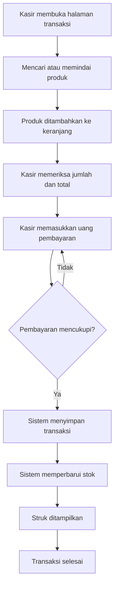

# PRODUCT REQUIREMENTS DOCUMENT (PRD)
## Sistem Informasi Kasir dan Manajemen Stok – KasirKu

**Versi:** 1.0  
**Tanggal:** 30 Oktober 2026  
**Platform:** Web responsif / Progressive Web App (PWA)  
**Target pengguna:** Toko kelontong / toko sembako  
**Perangkat:** HP, tablet, dan komputer

---

## 1. Ringkasan Produk

KasirKu merupakan aplikasi kasir berbasis web untuk membantu operasional toko kelontong atau toko sembako. Aplikasi berfokus pada pencatatan transaksi penjualan, pengelolaan produk, pemantauan persediaan, dan penyajian laporan penjualan.

Aplikasi dapat diakses melalui browser pada HP maupun komputer. Antarmuka menggunakan pendekatan *mobile-first* agar proses transaksi tetap mudah dilakukan melalui layar HP. Aplikasi juga dapat dikembangkan sebagai Progressive Web App (PWA), sehingga pengguna dapat menambahkan ikon aplikasi ke layar utama perangkat.

## 2. Latar Belakang

Proses penjualan dan pencatatan persediaan pada toko kelontong sering dilakukan secara manual. Cara tersebut dapat menyebabkan pencatatan transaksi kurang terstruktur, perhitungan total belanja membutuhkan waktu, dan pemantauan stok menjadi lebih sulit.

KasirKu dirancang untuk membantu pemilik atau petugas toko mengelola kegiatan tersebut dalam satu sistem. Transaksi dicatat secara digital, stok diperbarui otomatis setelah penjualan berhasil, dan informasi penjualan dapat dilihat kembali berdasarkan periode tertentu.

## 3. Tujuan Produk

1. Mempermudah dan mempercepat proses transaksi penjualan.
2. Mengelola data produk dan kategori secara terpusat.
3. Memperbarui stok secara otomatis setelah transaksi berhasil.
4. Mendukung satuan barang utuh maupun pecahan.
5. Mempermudah pencarian produk menggunakan nama atau barcode.
6. Menyediakan bukti transaksi digital dan cetak.
7. Menyajikan laporan penjualan dan informasi persediaan.
8. Memudahkan penggunaan aplikasi melalui HP maupun komputer.

## 4. Sasaran Pengguna

Aplikasi versi awal ditujukan untuk toko kelontong atau toko sembako dengan skala operasional kecil.

| Pengguna | Peran | Kebutuhan |
|---|---|---|
| Kasir / Pemilik Toko | Pengguna utama | Mengelola produk, melakukan transaksi, memantau stok, dan melihat laporan |

**Ketentuan akun:** versi awal menggunakan satu akun pengguna. Pengaturan hak akses untuk banyak kasir belum menjadi kebutuhan utama.

## 5. Ruang Lingkup Produk

### 5.1 Fitur yang Termasuk

- Login dan logout pengguna.
- Dashboard ringkasan aktivitas toko.
- Pengelolaan kategori dan data produk.
- Pengelolaan barcode produk.
- Pencarian produk secara manual.
- Pemindaian barcode melalui kamera atau scanner eksternal.
- Keranjang transaksi dan pembayaran tunai.
- Penghitungan total pembayaran dan kembalian.
- Pengurangan stok otomatis setelah transaksi berhasil.
- Pencatatan stok masuk.
- Dukungan satuan utuh dan pecahan.
- Riwayat transaksi.
- Struk digital dan cetak.
- Laporan penjualan berdasarkan periode.
- Tampilan responsif untuk HP dan komputer.

### 5.2 Fitur yang Belum Termasuk

- Pengelolaan banyak cabang toko.
- Banyak akun kasir dan pembagian hak akses.
- Integrasi pembayaran digital atau payment gateway.
- Integrasi akuntansi dan perpajakan.
- Pengelolaan pemasok secara lengkap.
- Program loyalitas pelanggan dan poin.
- Sinkronisasi transaksi offline secara otomatis.
- Aplikasi native Android atau iOS.

Fitur di luar ruang lingkup dapat dipertimbangkan untuk pengembangan versi berikutnya.

## 6. Platform dan Prinsip Penggunaan

KasirKu dikembangkan sebagai aplikasi web responsif yang dapat dibuka melalui browser modern.

| Perangkat | Cara Akses |
|---|---|
| HP Android | Browser atau ikon PWA |
| iPhone | Safari atau ikon PWA |
| Tablet | Browser |
| Komputer / Laptop | Browser |

Prinsip pengalaman pengguna:
- Mengutamakan tampilan HP (*mobile-first*).
- Navigasi sederhana dan mudah dipahami.
- Tombol transaksi nyaman disentuh.
- Informasi harga, jumlah, dan total pembayaran mudah dibaca.
- Mengurangi langkah yang tidak diperlukan.
- Menampilkan pesan yang jelas ketika terjadi kesalahan.
- Menjaga tampilan konsisten pada berbagai ukuran layar.

## 7. Struktur Menu

```text
KasirKu
├── Dashboard
├── Kasir
│   ├── Pencarian Produk
│   ├── Pemindaian Barcode
│   ├── Keranjang Belanja
│   └── Pembayaran
├── Produk
│   ├── Daftar Produk
│   ├── Tambah Produk
│   ├── Ubah Produk
│   └── Kategori
├── Persediaan
│   ├── Informasi Stok
│   ├── Stok Masuk
│   └── Riwayat Pergerakan Stok
├── Transaksi
│   ├── Riwayat Transaksi
│   └── Detail Transaksi
├── Laporan
│   ├── Laporan Penjualan
│   └── Ringkasan Periode
└── Pengaturan
    ├── Informasi Toko
    └── Akun Pengguna
```

Pada tampilan HP, menu dapat disederhanakan menggunakan navigasi bawah atau menu ringkas.

## 8. Kebutuhan Fungsional

### 8.1 Login dan Logout

- Pengguna memasukkan username dan password.
- Sistem memeriksa kecocokan data akun.
- Login berhasil mengarahkan pengguna ke dashboard.
- Sistem menampilkan pesan jika data login tidak sesuai.
- Pengguna dapat keluar melalui menu logout.

**Kriteria penerimaan:** akun valid dapat masuk; akun tidak valid ditolak; halaman internal hanya dapat diakses setelah login.

### 8.2 Dashboard

Informasi yang ditampilkan:
- Total penjualan hari ini.
- Jumlah transaksi hari ini.
- Jumlah produk aktif.
- Produk dengan stok menipis.
- Ringkasan transaksi terbaru.

**Kriteria penerimaan:** informasi berasal dari data tersimpan, dapat dibaca melalui HP, dan diperbarui setelah transaksi atau perubahan stok.

### 8.3 Pengelolaan Kategori

- Menambahkan kategori.
- Mengubah nama kategori.
- Menampilkan daftar kategori.
- Menonaktifkan kategori yang tidak digunakan.
- Mencegah kategori yang masih digunakan produk dihapus secara sembarangan.

### 8.4 Pengelolaan Produk

Data produk meliputi:
- Nama produk.
- Kode produk.
- Barcode.
- Kategori.
- Harga beli (opsional).
- Harga jual.
- Jumlah stok.
- Satuan dasar.
- Batas minimum stok.
- Status produk.

Pengguna dapat menambah, mengubah, melihat, mencari, dan menonaktifkan produk.

### 8.5 Pencarian dan Pemindaian Barcode

Metode pencarian:
1. Pencarian manual berdasarkan nama atau kode produk.
2. Pemindaian menggunakan kamera HP.
3. Pemindaian menggunakan barcode scanner USB atau Bluetooth.

**Kriteria penerimaan:** produk ditemukan jika barcode terdaftar; informasi produk ditampilkan; sistem memberi pesan jika barcode tidak dikenal; pencarian manual tetap tersedia.

### 8.6 Transaksi Penjualan

- Menambahkan produk ke keranjang.
- Mengubah jumlah produk.
- Menghapus produk dari keranjang.
- Memilih satuan penjualan yang tersedia.
- Menghitung subtotal dan total otomatis.
- Memasukkan nominal uang yang diterima.
- Menghitung uang kembalian.
- Menyimpan transaksi setelah pembayaran dikonfirmasi.

**Kriteria penerimaan:** perhitungan dilakukan otomatis; jumlah tidak boleh melebihi stok; transaksi berhasil memiliki nomor unik; transaksi gagal tidak mengurangi stok; detail transaksi dapat dilihat kembali.

### 8.7 Pengelolaan Stok Otomatis

- Stok berkurang setelah transaksi berhasil.
- Stok bertambah setelah stok masuk berhasil dicatat.
- Sistem menampilkan jumlah stok terkini.
- Sistem menyimpan riwayat perubahan stok.
- Sistem memberi informasi produk yang mencapai batas minimum stok.

Stok disimpan menggunakan satuan dasar. Satuan penjualan memiliki faktor konversi terhadap satuan dasar.

| Produk | Satuan Dasar | Jumlah Terjual | Pengurangan Stok |
|---|---|---:|---:|
| Beras | Kg | 0,5 Kg | 0,5 Kg |
| Gula | Kg | 1 Kg | 1 Kg |
| Minyak | Liter | 0,25 Liter | 0,25 Liter |

### 8.8 Stok Masuk

- Memilih produk yang akan ditambahkan stoknya.
- Memasukkan jumlah dan satuan stok masuk.
- Menyimpan tanggal dan jumlah stok masuk.
- Memperbarui stok setelah pencatatan berhasil.
- Menampilkan riwayat stok masuk.

### 8.9 Struk Transaksi

Informasi struk:
- Nama dan informasi toko.
- Nomor transaksi.
- Tanggal dan waktu transaksi.
- Daftar produk.
- Jumlah dan harga satuan.
- Subtotal dan total pembayaran.
- Uang yang diterima dan kembalian.

Sistem menampilkan struk setelah transaksi berhasil, menyediakan tampilan cetak, dan mendukung printer struk 58 mm atau 80 mm. Struk digital dapat dibagikan melalui fitur berbagi perangkat atau disalin sebagai informasi transaksi.

### 8.10 Riwayat Transaksi

- Menampilkan daftar transaksi.
- Menampilkan nomor dan waktu transaksi.
- Menampilkan total pembayaran.
- Menampilkan detail transaksi.
- Mencari transaksi berdasarkan nomor atau periode.

### 8.11 Laporan Penjualan

- Melihat penjualan harian.
- Melihat penjualan berdasarkan rentang tanggal.
- Menampilkan jumlah transaksi.
- Menampilkan total nilai penjualan.
- Menampilkan daftar transaksi pada periode terpilih.

## 9. Kebutuhan Nonfungsional

| Aspek | Persyaratan |
|---|---|
| Kemudahan penggunaan | Antarmuka sederhana dan mudah dipahami |
| Responsif | Dapat digunakan pada HP, tablet, dan komputer |
| Performa | Halaman dan proses transaksi dimuat secara efisien |
| Keamanan | Halaman internal memerlukan autentikasi |
| Konsistensi data | Transaksi dan perubahan stok tersimpan konsisten |
| Kompatibilitas | Mendukung browser modern |
| Ketersediaan | Dapat digunakan selama server dan koneksi tersedia |
| Pemeliharaan | Sistem mudah dikembangkan dan diperbaiki |
| Pencadangan | Database dapat dicadangkan berkala |

## 10. Alur Utama Penggunaan

### 10.1 Alur Transaksi Penjualan



### 10.2 Alur Pengelolaan Produk

1. Pengguna membuka menu produk.
2. Pengguna memilih tambah produk.
3. Pengguna mengisi informasi produk.
4. Sistem memvalidasi data.
5. Sistem menyimpan produk.
6. Produk tampil pada daftar dan dapat digunakan dalam transaksi.

### 10.3 Alur Stok Masuk

1. Pengguna membuka menu persediaan.
2. Pengguna memilih stok masuk.
3. Pengguna memilih produk.
4. Pengguna memasukkan jumlah stok.
5. Sistem memvalidasi data.
6. Sistem menyimpan catatan stok masuk.
7. Jumlah stok diperbarui.

## 11. Aturan Bisnis

1. Setiap transaksi memiliki nomor unik.
2. Produk harus berstatus aktif agar dapat dijual.
3. Produk harus memiliki harga jual sebelum dapat ditransaksikan.
4. Jumlah penjualan harus lebih besar dari nol.
5. Sistem tidak boleh memproses penjualan melebihi stok tersedia.
6. Stok berkurang hanya setelah transaksi berhasil disimpan.
7. Pembatalan atau kegagalan transaksi tidak boleh mengubah stok.
8. Perhitungan satuan pecahan mengikuti faktor konversi yang ditentukan.
9. Riwayat transaksi menyimpan informasi produk dan harga saat transaksi dilakukan.
10. Produk yang memiliki riwayat transaksi sebaiknya dinonaktifkan, bukan dihapus permanen.
11. Setiap perubahan stok memiliki catatan pergerakan stok.
12. Laporan penjualan dihitung berdasarkan transaksi berhasil.

## 12. Kebutuhan Antarmuka Pengguna

### 12.1 Pedoman Visual

| Elemen | Rekomendasi |
|---|---|
| Warna utama | Biru `#2563EB` |
| Latar belakang | Abu sangat muda `#F8FAFC` |
| Warna berhasil | Hijau `#16A34A` |
| Warna peringatan | Merah `#DC2626` |
| Tipografi | Inter atau Poppins |
| Gaya tampilan | Minimalis, bersih, dan mudah dibaca |
| Navigasi desktop | Sidebar |
| Navigasi mobile | Navigasi bawah atau menu ringkas |

### 12.2 Halaman Kasir pada HP

- Kolom pencarian produk ditempatkan pada area yang mudah dijangkau.
- Tombol pemindaian barcode terlihat jelas.
- Daftar produk dan keranjang ditampilkan ringkas.
- Total pembayaran ditampilkan secara menonjol.
- Tombol proses pembayaran mudah ditemukan.
- Jumlah barang dapat diubah tanpa membuka banyak halaman.

## 13. Integrasi dan Perangkat Pendukung

| Perangkat / Fitur | Keterangan |
|---|---|
| Kamera HP | Pemindaian barcode melalui browser |
| Barcode scanner USB | Dibaca sebagai input keyboard |
| Barcode scanner Bluetooth | Dibaca sebagai input keyboard jika kompatibel |
| Printer thermal | Mencetak struk 58 mm atau 80 mm |
| Fitur cetak browser | Alternatif pencetakan struk |
| PWA | Menambahkan ikon aplikasi ke layar utama HP |

Pemindaian melalui kamera memerlukan izin kamera dan HTTPS pada lingkungan produksi. Dukungan printer thermal bergantung pada kompatibilitas perangkat, browser, dan metode koneksi printer.

## 14. Batasan dan Asumsi

- Aplikasi digunakan oleh satu akun kasir pada versi awal.
- Aplikasi berfokus pada satu toko.
- Pembayaran versi awal menggunakan uang tunai.
- Aplikasi memerlukan koneksi ke server untuk memproses transaksi.
- Pengelolaan stok menggunakan satuan dasar dan faktor konversi.
- Pemindaian barcode bergantung pada ketersediaan kamera atau scanner.
- PWA membantu akses dari layar utama, tetapi tidak otomatis menjadikan transaksi dapat dilakukan secara offline.
- Integrasi pembayaran digital dan sinkronisasi offline berada di luar ruang lingkup awal.

## 15. Kriteria Keberhasilan Produk

Produk memenuhi kebutuhan versi awal apabila:
1. Pengguna dapat login dan logout.
2. Pengguna dapat mengelola kategori dan data produk.
3. Pengguna dapat mencari produk secara manual.
4. Pengguna dapat menemukan produk menggunakan barcode.
5. Pengguna dapat melakukan transaksi dan menghitung kembalian.
6. Stok berkurang otomatis setelah transaksi berhasil.
7. Sistem mendukung transaksi dengan satuan pecahan.
8. Pengguna dapat mencatat stok masuk.
9. Struk transaksi dapat ditampilkan dan dicetak.
10. Riwayat transaksi dan laporan penjualan dapat dilihat.
11. Fungsi utama dapat digunakan melalui HP dan komputer.
12. Sistem mencegah transaksi yang melebihi stok tersedia.

## 16. Prioritas Pengembangan

| Prioritas | Fitur | Keterangan |
|---|---|---|
| P0 – Wajib | Login, produk, kategori, transaksi, dan stok otomatis | Fondasi aplikasi kasir |
| P1 – Penting | Stok masuk, barcode, satuan pecahan, serta struk digital dan cetak | Mendukung operasional toko |
| P2 – Pengembangan | Dashboard, laporan, dan PWA | Meningkatkan kemudahan penggunaan |

## 17. Rekomendasi Pengembangan

Pengembangan KasirKu sebaiknya dimulai dari fungsi inti, yaitu pengelolaan produk, transaksi penjualan, dan pembaruan stok otomatis. Setelah fungsi utama berjalan dengan baik, fitur barcode, struk, laporan, dan PWA dapat dikembangkan secara bertahap.

Dengan ruang lingkup yang terukur dan antarmuka yang mengutamakan perangkat mobile, KasirKu dapat dikembangkan sebagai sistem kasir sederhana yang sesuai dengan kebutuhan operasional toko kelontong atau toko sembako.

---

**Akhir Dokumen PRD KasirKu**
