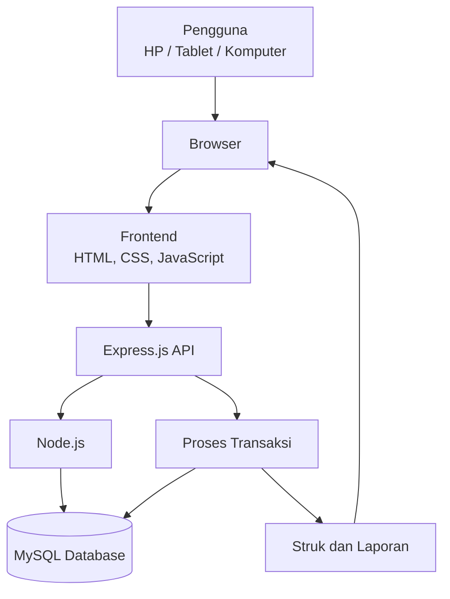

# TECHNICAL REQUIREMENTS DOCUMENT (TRD)
## Sistem Informasi Kasir dan Manajemen Stok – KasirKu

**Versi:** 1.0  
**Platform:** Web responsif / Progressive Web App (PWA)  
**Target perangkat:** HP, tablet, dan komputer  
**Backend:** Node.js + Express.js  
**Database:** MySQL  

---

## 1. Gambaran Umum

KasirKu merupakan aplikasi kasir berbasis web yang dirancang untuk membantu operasional toko kelontong atau sembako dalam melakukan transaksi penjualan, mengelola data produk, serta memantau persediaan barang.

Aplikasi menggunakan desain responsif agar dapat dioperasikan melalui HP maupun komputer tanpa harus memasang aplikasi dari toko aplikasi. Sistem dirancang dengan teknologi yang relatif ringan, mudah dikembangkan, dan mudah dipelihara.

## 2. Tujuan Pengembangan

1. Mempermudah proses transaksi penjualan melalui HP maupun komputer.
2. Mempercepat pencarian produk menggunakan nama atau barcode.
3. Mengelola stok barang secara otomatis setelah transaksi berhasil.
4. Mendukung satuan barang utuh maupun pecahan.
5. Menyediakan laporan penjualan dan persediaan barang.
6. Menghasilkan struk digital dan struk yang dapat dicetak.
7. Menyediakan antarmuka yang sederhana dan nyaman digunakan pada layar HP.

## 3. Teknologi yang Digunakan

| Komponen | Teknologi | Fungsi |
|---|---|---|
| Runtime backend | Node.js LTS | Menjalankan aplikasi backend |
| Backend framework | Express.js | Mengelola routing dan API |
| Database | MySQL 8.0 | Menyimpan data aplikasi |
| Database driver | mysql2 | Menghubungkan Node.js dengan MySQL |
| Frontend | HTML, CSS, JavaScript | Membangun antarmuka pengguna |
| CSS framework | Bootstrap 5 | Membuat tampilan responsif |
| Barcode scanner | @zxing/browser | Membaca barcode melalui kamera |
| Password hashing | bcrypt | Mengamankan password |
| Session | express-session | Mengelola sesi login |
| Validasi | Zod | Memvalidasi data masukan |
| PWA | Web App Manifest dan Service Worker | Memungkinkan aplikasi ditambahkan ke layar utama HP |
| Web server | Nginx (opsional) | Reverse proxy untuk deployment |

**Prinsip pemilihan teknologi:** menggunakan teknologi yang umum, stabil, dan tidak memerlukan framework frontend yang berat. Frontend cukup menggunakan HTML, CSS, JavaScript, dan Bootstrap 5.

## 4. Spesifikasi Perangkat

### 4.1 Perangkat Pengguna

| Komponen | Rekomendasi Minimum |
|---|---|
| HP Android | Android 9 atau lebih baru |
| iPhone | iOS 15 atau lebih baru |
| RAM perangkat | 2 GB |
| Browser | Chrome, Safari, atau browser modern |
| Koneksi | Internet atau jaringan lokal yang terhubung ke server |
| Kamera | Dibutuhkan untuk pemindaian barcode melalui kamera |
| Barcode scanner eksternal | Opsional, USB atau Bluetooth |

### 4.2 Perangkat Server

| Komponen | Rekomendasi |
|---|---|
| Runtime | Node.js LTS |
| Database | MySQL 8.0 |
| Sistem operasi | Linux atau Windows |
| RAM | Minimal 1 GB untuk skala penggunaan kecil |
| Penyimpanan | SSD |
| Web server | Nginx atau server Node.js secara langsung |
| Protokol | HTTPS untuk penggunaan melalui internet |

Spesifikasi server aktual dapat disesuaikan dengan jumlah produk, volume transaksi, dan jumlah perangkat yang mengakses aplikasi.

## 5. Kebutuhan Fungsional

| No. | Modul | Kebutuhan Teknis |
|---|---|---|
| 1 | Login | Autentikasi menggunakan satu akun kasir |
| 2 | Dashboard | Menampilkan ringkasan penjualan dan informasi stok |
| 3 | Data produk | Menambah, mengubah, dan menonaktifkan produk |
| 4 | Kategori | Mengelompokkan produk |
| 5 | Transaksi | Menambahkan produk ke keranjang dan menghitung total |
| 6 | Barcode | Mencari produk melalui barcode |
| 7 | Stok | Mengurangi stok otomatis setelah transaksi berhasil |
| 8 | Satuan | Mendukung satuan utuh dan pecahan |
| 9 | Struk | Menampilkan, membagikan, dan mencetak bukti transaksi |
| 10 | Laporan | Menampilkan laporan penjualan berdasarkan periode |
| 11 | Stok masuk | Mencatat penambahan persediaan barang |

## 6. Rancangan Antarmuka Mobile

Antarmuka menggunakan pendekatan **mobile-first**, yaitu mengutamakan kenyamanan penggunaan pada layar HP sebelum disesuaikan untuk tablet dan komputer.

### 6.1 Ketentuan Desain Mobile

- Menggunakan layout satu kolom pada layar HP.
- Tombol utama memiliki ukuran yang nyaman disentuh.
- Navigasi dibuat sederhana dan mudah dijangkau.
- Form input tidak terlalu panjang.
- Daftar produk dan transaksi ditampilkan sebagai kartu atau daftar pada layar kecil.
- Keranjang belanja mudah diakses saat transaksi.
- Teks dan angka menggunakan ukuran yang mudah dibaca.
- Menghindari animasi dan elemen visual yang tidak diperlukan.
- Tombol pembayaran dibuat jelas dan mudah ditemukan.

### 6.2 Halaman Utama

| Halaman | Isi dan Fungsi |
|---|---|
| Login | Form username dan password |
| Dashboard | Ringkasan penjualan, transaksi, dan stok |
| Kasir | Pencarian produk, barcode, keranjang, dan pembayaran |
| Produk | Daftar dan pengelolaan produk |
| Stok | Informasi stok dan pencatatan stok masuk |
| Laporan | Rekap penjualan berdasarkan periode |
| Pengaturan | Informasi toko dan pengaturan dasar |

## 7. Arsitektur Sistem

Sistem menggunakan arsitektur client-server sederhana. Browser menampilkan antarmuka, Express.js memproses permintaan aplikasi, dan MySQL menyimpan data.



## 8. Struktur Folder Aplikasi

```text
kasirku/
├── public/
│   ├── css/
│   │   └── style.css
│   ├── js/
│   │   ├── app.js
│   │   ├── kasir.js
│   │   └── barcode.js
│   ├── images/
│   ├── manifest.json
│   └── service-worker.js
│
├── src/
│   ├── config/
│   │   └── database.js
│   ├── controllers/
│   │   ├── authController.js
│   │   ├── productController.js
│   │   ├── transactionController.js
│   │   ├── stockController.js
│   │   └── reportController.js
│   ├── middleware/
│   │   └── authMiddleware.js
│   ├── routes/
│   │   ├── authRoutes.js
│   │   ├── productRoutes.js
│   │   ├── transactionRoutes.js
│   │   ├── stockRoutes.js
│   │   └── reportRoutes.js
│   ├── services/
│   │   └── stockService.js
│   └── app.js
│
├── views/
│   ├── login.html
│   ├── dashboard.html
│   ├── kasir.html
│   ├── produk.html
│   ├── stok.html
│   └── laporan.html
│
├── database/
│   └── kasirku.sql
│
├── .env
├── .env.example
├── package.json
└── server.js
```

Struktur folder dapat disesuaikan selama pemisahan konfigurasi, route, controller, service, dan file tampilan tetap jelas.

## 9. Rancangan Database

Database menggunakan MySQL dengan tabel inti berikut.

| No. | Nama Tabel | Fungsi |
|---|---|---|
| 1 | users | Menyimpan akun pengguna |
| 2 | store_settings | Menyimpan informasi toko |
| 3 | categories | Menyimpan kategori produk |
| 4 | products | Menyimpan data produk |
| 5 | product_units | Menyimpan satuan dan faktor konversi |
| 6 | product_barcodes | Menyimpan barcode produk |
| 7 | transactions | Menyimpan data transaksi penjualan |
| 8 | transaction_details | Menyimpan detail produk yang dijual |
| 9 | stock_entries | Menyimpan data stok masuk |
| 10 | stock_entry_details | Menyimpan detail stok masuk |
| 11 | stock_movements | Mencatat perubahan stok |

### 9.1 Ketentuan Database

- Gunakan tipe `DECIMAL` untuk harga dan jumlah stok yang dapat berupa pecahan.
- Gunakan primary key dan foreign key untuk menjaga hubungan data.
- Barcode produk harus unik jika kebijakan toko menetapkan satu barcode untuk satu produk.
- Simpan nama produk, harga, dan satuan pada detail transaksi sebagai snapshot agar riwayat transaksi tidak berubah ketika data produk diperbarui.
- Produk yang sudah memiliki riwayat transaksi sebaiknya dinonaktifkan, bukan dihapus permanen.
- Gunakan transaksi database ketika menyimpan transaksi dan memperbarui stok.

## 10. Ketentuan Teknis Transaksi dan Stok

### 10.1 Alur Transaksi

1. Kasir mencari produk berdasarkan nama atau memindai barcode.
2. Sistem mengambil informasi produk dari database.
3. Produk ditambahkan ke keranjang.
4. Kasir menentukan jumlah pembelian dan satuan.
5. Sistem menghitung subtotal dan total pembayaran.
6. Kasir memasukkan jumlah uang yang diterima.
7. Sistem menghitung kembalian.
8. Setelah pembayaran dikonfirmasi, sistem menyimpan transaksi dan detailnya.
9. Stok produk dikurangi sesuai jumlah yang terjual.
10. Sistem menampilkan struk transaksi.

### 10.2 Pengelolaan Satuan

Stok disimpan menggunakan satuan dasar agar perhitungan lebih konsisten. Satuan penjualan menggunakan faktor konversi terhadap satuan dasar.

Contoh:

| Produk | Satuan Dasar | Jumlah Terjual | Pengurangan Stok |
|---|---|---:|---:|
| Beras | Kg | 0,5 Kg | 0,5 Kg |
| Gula | Kg | 1 Kg | 1 Kg |
| Minyak | Liter | 0,25 Liter | 0,25 Liter |

### 10.3 Validasi Stok

- Sistem tidak mengizinkan penjualan melebihi stok yang tersedia.
- Stok diperbarui hanya setelah transaksi berhasil disimpan.
- Transaksi yang gagal tidak boleh mengurangi stok.
- Perubahan stok harus tercatat dalam tabel `stock_movements`.
- Proses penyimpanan transaksi dan pengurangan stok harus dilakukan dalam satu database transaction agar data tetap konsisten.
- Gunakan penguncian baris saat memeriksa dan memperbarui stok untuk mencegah dua proses mengurangi stok yang sama secara bersamaan.

## 11. Ketentuan Barcode

Sistem mendukung dua metode pemindaian barcode:

1. **Kamera HP:** menggunakan library `@zxing/browser` melalui browser.
2. **Barcode scanner eksternal:** menggunakan scanner USB atau Bluetooth yang terbaca sebagai input keyboard.

Pemindaian melalui kamera memerlukan izin kamera dari pengguna dan koneksi HTTPS pada lingkungan produksi. Jika kamera tidak tersedia atau barcode tidak terbaca, kasir tetap dapat mencari produk secara manual.

## 12. Rancangan API

Contoh endpoint API yang digunakan:

| Metode | Endpoint | Fungsi |
|---|---|---|
| POST | `/api/auth/login` | Login pengguna |
| POST | `/api/auth/logout` | Logout pengguna |
| GET | `/api/products` | Mengambil daftar produk |
| POST | `/api/products` | Menambahkan produk |
| PUT | `/api/products/:id` | Mengubah produk |
| GET | `/api/products/barcode/:code` | Mencari produk berdasarkan barcode |
| GET | `/api/categories` | Mengambil daftar kategori |
| POST | `/api/transactions` | Menyimpan transaksi |
| GET | `/api/transactions` | Mengambil riwayat transaksi |
| POST | `/api/stock-entries` | Mencatat stok masuk |
| GET | `/api/reports/sales` | Mengambil laporan penjualan |

Seluruh endpoint yang berhubungan dengan data internal harus dilindungi autentikasi dan validasi sesuai kebutuhan.

## 13. Keamanan Sistem

| No. | Ketentuan | Implementasi |
|---|---|---|
| 1 | Autentikasi | Login menggunakan username dan password |
| 2 | Password | Disimpan menggunakan bcrypt |
| 3 | Session | Menggunakan konfigurasi session yang aman |
| 4 | Validasi | Validasi data pada sisi server |
| 5 | Database | Menggunakan prepared statements melalui mysql2 |
| 6 | Transaksi | Menggunakan database transaction |
| 7 | Konfigurasi | Menyimpan rahasia aplikasi di file environment |
| 8 | HTTPS | Menggunakan HTTPS pada server produksi |
| 9 | Backup | Menyediakan pencadangan database secara berkala |

## 14. Optimasi Performa

Agar aplikasi tetap ringan saat digunakan melalui HP:

1. Gunakan HTML, CSS, JavaScript, dan Bootstrap 5 tanpa framework frontend tambahan yang berat.
2. Muat data seperlunya dan gunakan pagination untuk daftar produk serta transaksi.
3. Optimalkan ukuran gambar produk.
4. Gunakan query database yang efisien dan indeks pada kolom pencarian.
5. Hindari animasi dan komponen visual yang tidak diperlukan.
6. Minimalkan jumlah library tambahan.
7. Gunakan cache hanya untuk data yang aman dan jarang berubah.
8. Pastikan halaman kasir tetap mudah digunakan pada layar kecil.

## 15. Ketentuan PWA dan Operasional Mobile

Aplikasi dapat dikembangkan sebagai Progressive Web App (PWA) agar pengguna dapat menambahkan ikon KasirKu ke layar utama HP dan membukanya seperti aplikasi biasa.

Ketentuan implementasi:

- Menyediakan `manifest.json` berisi nama aplikasi, ikon, warna tema, dan mode tampilan.
- Menyediakan service worker untuk menyimpan aset statis yang diperlukan.
- Menggunakan HTTPS pada lingkungan produksi.
- Menampilkan indikator ketika koneksi internet terputus.
- Menyediakan tampilan yang tetap informatif ketika server tidak dapat diakses.

**Batasan versi awal:** sistem menggunakan pendekatan online-first. Transaksi memerlukan koneksi ke server agar data penjualan dan stok tetap konsisten. Penyimpanan transaksi offline dan sinkronisasi otomatis belum termasuk dalam ruang lingkup versi awal.

## 16. Pengujian Sistem

| No. | Skenario Pengujian | Hasil yang Diharapkan |
|---|---|---|
| 1 | Login menggunakan akun valid | Pengguna berhasil masuk |
| 2 | Login menggunakan data tidak valid | Sistem menolak login |
| 3 | Membuka aplikasi melalui HP | Tampilan menyesuaikan layar |
| 4 | Menambahkan produk ke keranjang | Produk masuk ke keranjang |
| 5 | Memindai barcode | Produk ditemukan |
| 6 | Melakukan transaksi | Transaksi tersimpan |
| 7 | Menyelesaikan pembayaran | Stok berkurang otomatis |
| 8 | Menjual barang pecahan | Stok berkurang sesuai konversi |
| 9 | Menjual melebihi stok | Sistem menolak transaksi |
| 10 | Mencetak struk | Struk dapat dicetak |
| 11 | Membuka laporan | Data laporan ditampilkan |
| 12 | Mengakses melalui komputer | Tampilan menyesuaikan layar |
| 13 | Mengakses saat koneksi terputus | Sistem menampilkan informasi koneksi |

## 17. Prioritas Pengembangan

| Tahap | Fitur |
|---|---|
| Tahap 1 – Fitur Utama | Login, kategori, data produk, transaksi, dan pengelolaan stok otomatis |
| Tahap 2 – Fitur Pendukung | Barcode, satuan pecahan, stok masuk, serta struk digital dan cetak |
| Tahap 3 – Penyempurnaan | Dashboard, laporan, PWA, backup, dan optimasi performa |

## 18. Kesimpulan

TRD KasirKu menggunakan Node.js dan Express.js sebagai teknologi backend, MySQL sebagai database, serta HTML, CSS, JavaScript, dan Bootstrap 5 untuk membangun antarmuka. Kombinasi tersebut dipilih agar sistem memiliki struktur pengembangan yang sederhana dan dapat dioperasikan melalui HP maupun komputer.

Dengan pendekatan mobile-first dan PWA, KasirKu diharapkan dapat membantu kegiatan transaksi penjualan serta pengelolaan persediaan toko kelontong secara praktis, ringan, dan terstruktur.
